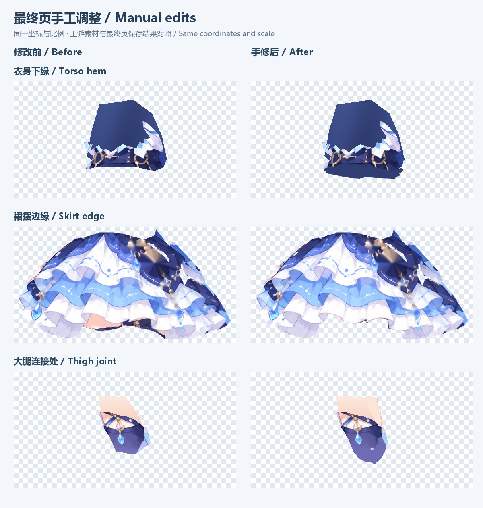

<div align="center">


# picture2animation

**Turn a character illustration into an editable 2D animation.**

AI prepares the cutouts, repairs, and animation. Review and edit each step in your browser.

[中文](README.md) · **English**

[Workflow](#workflow) · [Quick start](#quick-start) · [Skill docs](character-rig-design/SKILL.md) · [Motion example](character-rig-design/references/dafeiyu-motion-example.md)

<table>
  <tr>
    <th align="center">Original</th>
    <th align="center">Animation</th>
  </tr>
  <tr>
    <td align="center" width="50%"></td>
    <td align="center" width="50%"></td>
  </tr>
</table>

*Featuring Dafeiyu. Idle, start, run, and stop, recorded from the actual player.*

</div>

picture2animation is a character animation skill with six stage guides, browser editing tools, and a complete example. Give your AI a character illustration and work through skeleton placement, cutouts, repairs, binding, and animation. Review each stage in the browser before moving on.

You can drag a cutout boundary, move misplaced pixels to another layer, or touch up a repair by hand. The final animation page supports draw-order changes and texture editing while you preview the result. Each stage keeps its page and data for later review or revision.

## Workflow


The screenshots below follow Dafeiyu through the actual workflow. Along the way, the arms and legs swung on the same side, a face repair rounded off the chin, and the stop animation raised the hands too high. Those fixes helped shape the editing tools included here.

All six browser templates, their generators, and stage guides are included. For a new character, reuse the tools and have your AI prepare that character's data.

### 01 Skeleton placement

AI marks the head, neck, chest, shoulders, elbows, wrists, hips, knees, and ankles on the source image, then adds anchors for hair and accessories. Drag the points to correct its estimates, including joints hidden under clothing. Node names and parent relationships are editable too.


### 02 Part separation

Each cutout gets a colored overlay following its silhouette, with numbers showing draw order. Edit the boundaries with your mouse or select two layers to transfer misplaced pixels. Eyes, brows, and the mouth are separate parts, with a blank face underneath for expressions.


<details>
<summary>Face and expression cutouts</summary>


</details>

### 03 Repair plan

Inspect each part on its own for missing areas, stray pixels, and rough edges. AI suggests completion, cleanup, or local SVG redraws. Select or deselect those suggestions and leave notes for individual parts. Repairs begin after you approve the plan.


### 04 Material repair

Compare the repaired parts against the originals for changes in silhouette, color, and filled areas. Dafeiyu needed another pass here: AI had rounded the chin and lost some of the original shading. A color picker, brush, and eraser let you fix small details yourself. Saved edits carry forward to the next stages.


<details>
<summary>Pixel editing tools</summary>


</details>

### 05 Binding and expressions

Assign a driving node to each part and test the binding by rotating joints. Six draggable eye-guide points define the moving eyelid region. The lids approach each other, then switch to the corresponding closed-eye texture at full closure. Use the enlarged face preview to check for unwanted skin movement or leftover lash pixels.


<details>
<summary>Full-body binding preview</summary>


</details>

### 06 Animation and editing

Generate idle, start, run, and stop clips, then check loops and transitions in the same page. Pause, slow down, or scrub through the animation. Click a part in the player to adjust draw order or edit pixels, or select two layers for the two-color boundary editor. If a sleeve seam opens up, pause on that frame and fix it there.


**Offline example:** Download the repository and open the [interactive Dafeiyu example](character-rig-design/assets/examples/dafeiyu/index.html) in a browser. It embeds its assets and scripts, works offline, and lets you inspect the skeleton, play all four clips, and test live transitions. GitHub displays the HTML source; download the file and open it locally to use the player.

## Quick start

Use an AI environment that can inspect images, work with local files, and run Python. AI follows the skill to prepare character data and generate review pages; you check and edit the results in your browser. The review UI and detailed skill instructions are currently in Chinese.

```bash
git clone https://github.com/aplainjane/picture2animation.git
cd picture2animation
python -m pip install -r requirements.txt
```

Give your AI the illustration and this request:

```text
Use character-rig-design/SKILL.md in this repository.
Start with this character image and run stage 01.
Generate the editable skeleton review page using the existing template.
Wait for my confirmation in the browser before moving to the next stage.
```

To continue an existing project:

```text
Restore this character project and inspect its workflow and latest draft first.
Keep my edited textures, draw order, and bindings.
This time, only adjust the stop animation.
```

You can also place `character-rig-design/` in your AI tool's skill directory for repeated use. The main skill loads the relevant guide for each stage.

**Environment:** Python 3, Pillow, NumPy, SciPy, and a modern browser. The optional SVG-to-PNG helper also uses Node.js, Playwright, and Chromium; see [stage 04](character-rig-design/stages/04-material-result.md).

## Stages and outputs

| Stage | What you review | What goes forward |
| --- | --- | --- |
| 01 Structure | Joint positions, left/right semantics, parents | Structure and skeleton coordinates |
| 02 Separation | Boundaries, draw order, blank face, expressions | Current cutouts and crop offsets |
| 03 Plan | Completion, local SVG work, cleanup selections | Your selected repair plan and notes |
| 04 Materials | Repairs, colors, seams | Final materials |
| 05 Binding | Driving nodes, joint tests, eye guides | Bindings and expression assets |
| 06 Motion | Loops, transitions, final textures and draw order | Animation HTML, complete JSON, version metadata |

Each stage starts with a handoff card covering inputs, browser actions, save and approval buttons, and output locations.

- **Save a draft** to keep working on the current design.
- **Approve a stage** in the browser to produce `confirmed.json`. AI checks that approval before using it downstream.
- **Export or download** a copy of the current result. A playable delivery can be exported before final approval, with its actual status recorded.

Downloads and individual “checked” flags do not stand in for stage approval. Your texture edits, guides, layer order, and bindings carry forward.

## Directory structure

```text
picture2animation/
├── README.md                    Chinese home page
├── README.en.md                 English
├── docs/media/                  Real screenshots, GIF, and project icon
└── character-rig-design/
    ├── SKILL.md                 AI entry point
    ├── stages/                  Six stage guides and handoff cards
    ├── references/              Formats, reuse rules, and motion example guide
    ├── scripts/                 Generators, review service, checkpoints, exports
    └── assets/                  Six browser templates and runtime scripts
        └── examples/dafeiyu/    Complete, self-contained offline example
```

Each character gets a separate project directory:

```text
your-character-project/
├── input/                       Original image and generator inputs
├── stage01-review.html          Review pages, through stage06
├── stage01-review.workflow/     A separate workflow directory for each stage
│   ├── draft.json              Latest saved draft
│   ├── confirmed.json          Human-approved snapshot
│   └── workflow.json           Stage, revision, and dependencies
├── history/                     Read-only stage snapshots
├── review-history.html          History index
└── delivery/                    Playable HTML, complete JSON, release.json
```

See [project artifacts and handoff rules](character-rig-design/references/project-artifacts.md) for the commands and file locations. Resume from the latest draft, and use a valid approved snapshot downstream, so manual work does not get replaced by an older export.

## Scope and limitations

The current workflow supports idle motion, blinks, in-place running, and transitions for 2D cutout characters. Dafeiyu is the complete worked example in this repository. New characters still need their cutouts, bindings, and motion checked at each stage.

The current renderer uses single-bone rigid cutouts and local strip deformation. Large turns, perspective changes, and newly exposed hidden regions need additional art or design work. There is no mesh skinning, IK solver, or Spine project export. New illustrations still need image-specific separation and repair decisions. The motion preset is a starting point to adapt to the character's proportions, rest directions, and requested movement.

## Documentation and feedback

- [Main skill](character-rig-design/SKILL.md): stage routing and shared rules.
- [Template reuse](character-rig-design/references/template-reuse.md): how another AI can call the existing tools.
- [Dafeiyu motion example](character-rig-design/references/dafeiyu-motion-example.md): four clips, live transitions, and the small stop gesture.
- [Motion JSON](character-rig-design/assets/examples/dafeiyu/motion.json): image-free data for studying individual node tracks.

There is still plenty to improve in this workflow. If a stage guide is unclear, an editing tool is awkward, a handoff loses your changes, or the process is hard to reuse with another illustration, please open an [Issue](https://github.com/aplainjane/picture2animation/issues). Tell me which stage you reached, what you expected to do, and where you got stuck. Suggestions, alternative workflows, and PRs are welcome too.

## Manual editing examples

I also made some of Dafeiyu's final adjustments by hand. These comparisons show the materials entering the final stage and the edits I saved in the animation page, using the same coordinates and scale on both sides.



You can make these local adjustments in the stage 06 editor:

| Area | How to edit it |
| --- | --- |
| Torso hem | Pick an existing dark clothing color and paint along the lower edge, leaving some overlap for areas exposed during motion. |
| Skirt edge | Erase stray pixels. If pixels belong to the leg, use the two-layer transfer tool to move them to that layer. |
| Thigh joint | Pick a nearby skin color and fill the joint area with a small brush. Check the overlap during crouching and stepping, then clean the edge with the eraser. |

1. Pause on the pose you want to adjust. Click a part and double-click to open the editor, or select it in the layer list and click “手修选中素材” (edit selected material).
2. Use the color picker, brush, and eraser for touch-ups. To redistribute pixels, click “点选两块” (pick two parts), select both layers, and click “编辑这两层” (edit these layers).
3. In the two-layer editor, cyan marks A and orange marks B. Choose the active layer, then brush along the boundary with “扩大当前层” (expand current layer) or “划给另一层” (give to the other layer). The animation preview updates alongside it.
4. Click “保存素材” (save materials), check the animation, and export again. Unsaved brush strokes stay local and are not submitted to the project.

The offline example is for playback and review. Use the stage 06 editing page to save material changes. See [final-page layer and material editing](character-rig-design/stages/06-motion-production.md#最终页图层与素材微调) for the save rules.

## Personal notes

> **Note:** In my experience so far, **GPT-6.1-sol** is sufficient for part separation and skeleton binding. For animation generation, I would suggest **Claude Opus 5.5**; I tend to get more natural motion from it. GPT's understanding and sequencing of movement sometimes still feel a little off to me. This is my personal experience, offered as a reference.

## Disclaimer

This is my personal character-animation experiment, shared to document the workflow, tools, and what I learned along the way.

- **Artwork:** Character images, cutouts, animations, screenshots, and icons in this repository demonstrate the workflow. I claim no rights to any third-party characters, original illustrations, or other artwork included in them; those rights remain with their respective holders. Displaying these materials here does not grant permission to repost, redistribute, or use them commercially.
- **Your use:** Before processing images, publishing results, or using them commercially, check the permissions for the source images, characters, and related assets, and follow the terms of the models and services you use. I cannot obtain those permissions on your behalf or warrant that a particular use is authorized.
- **Results:** The tools and AI outputs are provided as is and may contain separation, repair, binding, or animation errors. Keep backups of source images and projects, and review the final results yourself. To the extent permitted by applicable law, I am not liable for data loss, rights disputes, or other losses arising from use of this project.
- **Rights concerns:** If you are a rights holder and have concerns about content displayed or included here, please open an [Issue](https://github.com/aplainjane/picture2animation/issues) identifying the content and explaining your rights. I will review it and address it promptly, including adding attribution, replacing, or removing the material as appropriate.
