<div align="center">


# picture2animation

**从一张立绘制作可编辑的 2D 角色动画。**

AI 拆图、补图、做动画，你在网页里检查和调整。

**中文** · [English](README.en.md)

[制作流程](#制作流程) · [快速开始](#快速开始) · [Skill 文档](character-rig-design/SKILL.md) · [动作示例](character-rig-design/references/dafeiyu-motion-example.md)

<table>
  <tr>
    <th align="center">原图</th>
    <th align="center">动画</th>
  </tr>
  <tr>
    <td align="center" width="50%">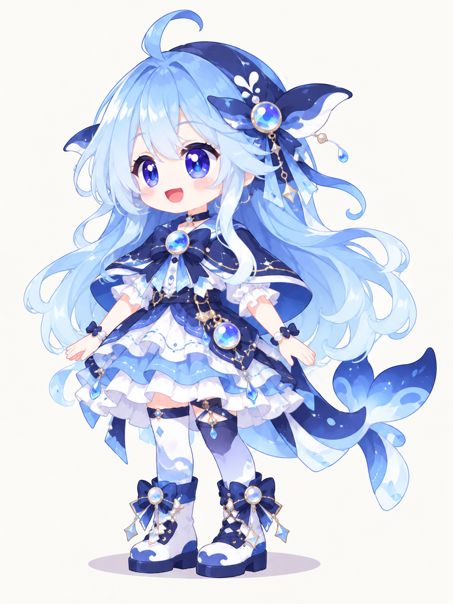</td>
    <td align="center" width="50%">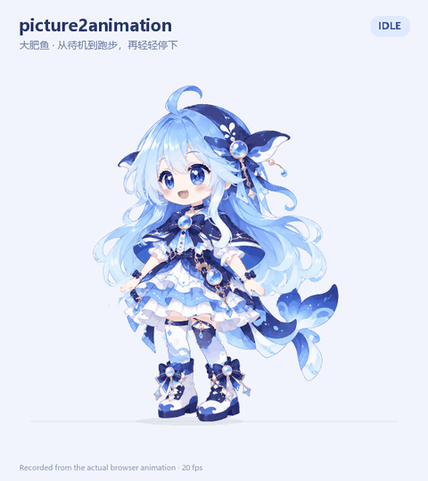</td>
  </tr>
</table>

*出镜：大肥鱼。待机、起跑、跑步、收步，录自实际动画页面。*

</div>

picture2animation 是一套角色动画 Skill，包含六个阶段的操作说明、网页编辑工具和一个完整示例。把角色图交给 AI，从骨骼定位开始，逐步完成拆图、补全、绑定和动画。每一步都能在浏览器里检查，确认后再继续。

拆错的轮廓可以拖，分错的像素可以还给另一层，补图补得不对可以自己画两笔。角色跑起来之后，依然能在动画页面调整层序、修素材，边改边看效果。每个阶段的网页和数据都会保留，方便回看或接着修改。

## 制作流程

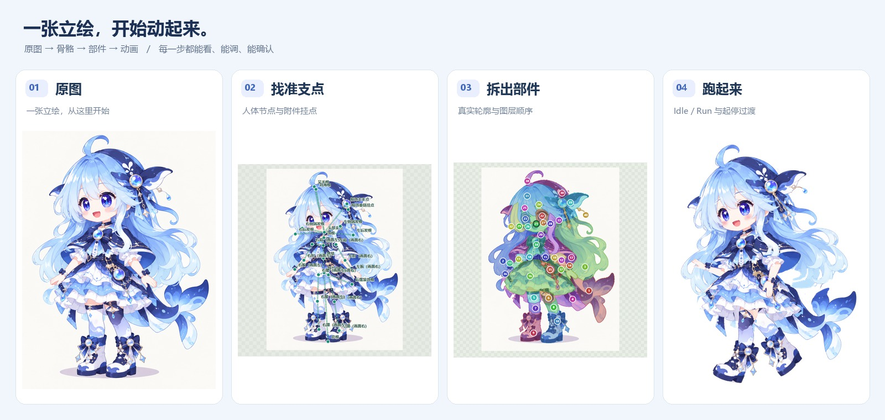

下面用大肥鱼走一遍完整流程，截图都来自实际制作页面。这个例子也经历过同手同脚、脸被补圆、收步时手抬得太高。现在这些检查和修改都能在对应的网页里完成。

六个阶段的网页模板、生成脚本和操作说明都在仓库里。换角色时继续用这套工具，由 AI 重新准备该角色的数据。

### 01 骨骼定位

AI 先在原图上标出头、颈、胸、肩、肘、腕、髋、膝、踝，再补头发和饰品的挂点。被衣服遮住的关节先估位置，你可以用鼠标拖动校准，也可以改节点名称和父子关系。

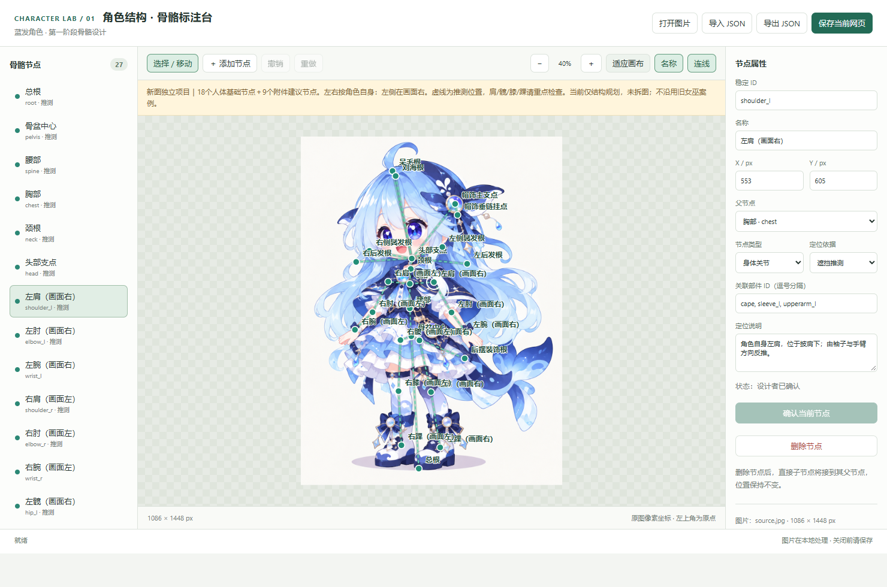

### 02 部件拆分

拆出的部件按轮廓叠上不同颜色，数字标出图层顺序。轮廓可以用鼠标调整，也能选中两层，把分错的像素转过去。眼睛、眉毛、嘴单独拆出，下面保留没有五官的面部底图，用于后续表情动画。

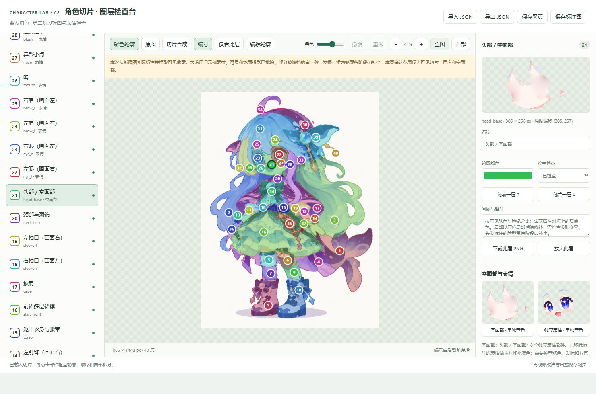

<details>
<summary>面部与表情拆分截图</summary>

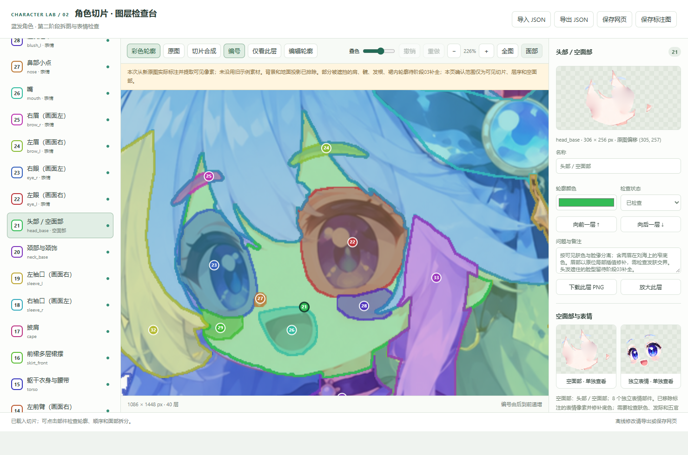

</details>

### 03 补全计划

独立展示所有部件，检查遮挡处的缺口、多余像素和边缘。AI 标出建议补全、清理或局部 SVG 重绘的部分，你可以逐块勾选、取消、写备注。确认计划后才开始处理素材。

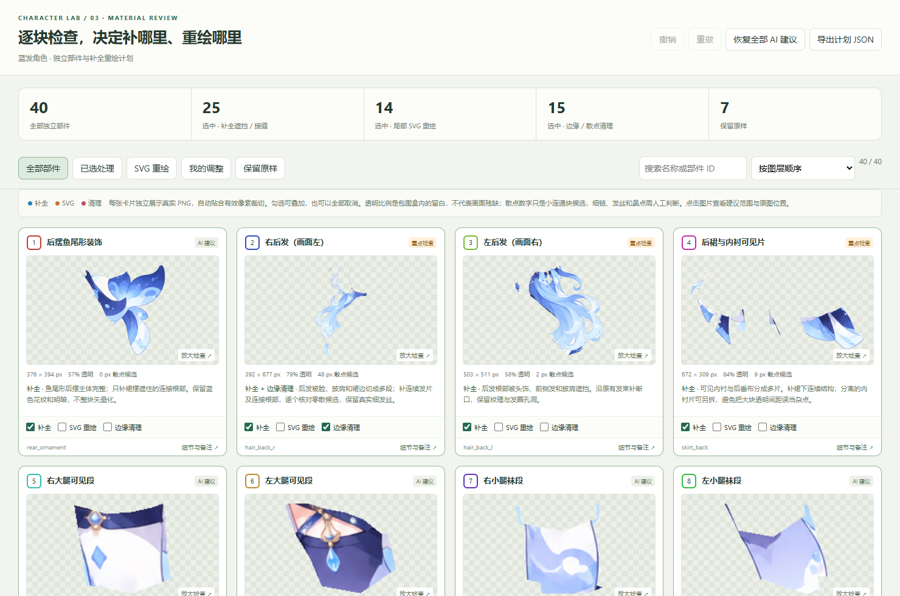

### 04 素材修复

对比修复前后，检查轮廓、颜色和新补的区域。大肥鱼的脸在这里返工过：AI 把下巴补圆了，还丢了原来的颜色细节，后来按原图修了回来。局部小问题可以直接用取色器、画笔和橡皮处理，保存后的素材会用于后续阶段。

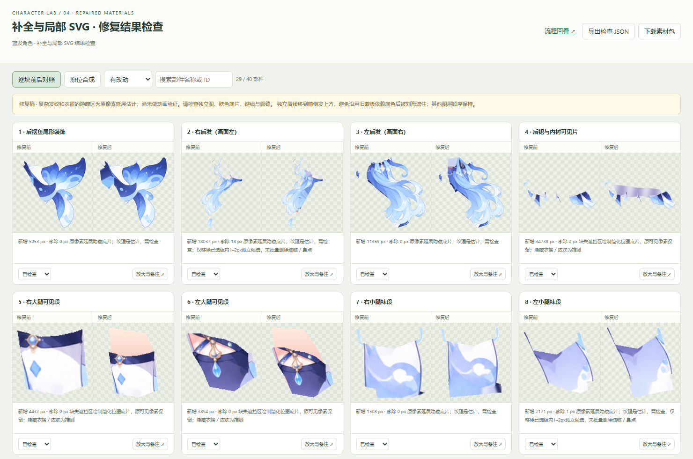

<details>
<summary>像素编辑工具截图</summary>

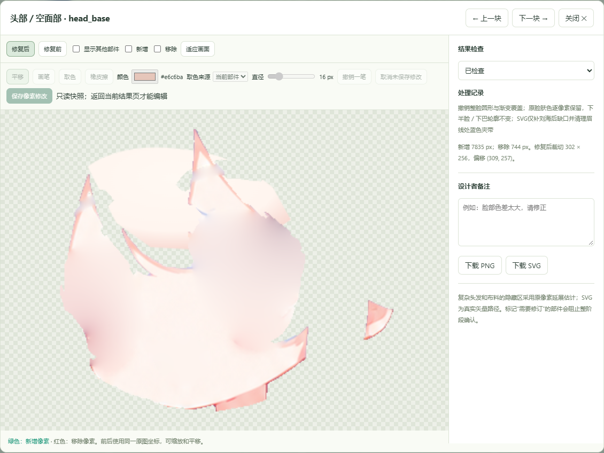

</details>

### 05 绑定与表情

给部件指定驱动节点，转动关节检查绑定。眼睛用可拖动的六点控制架限定运动区域，上下眼睑靠近闭合，完全闭合时切换对应的闭眼贴图。可以放大脸部预览，检查眼睑是否带动了周围皮肤、闭眼时是否残留眼线。

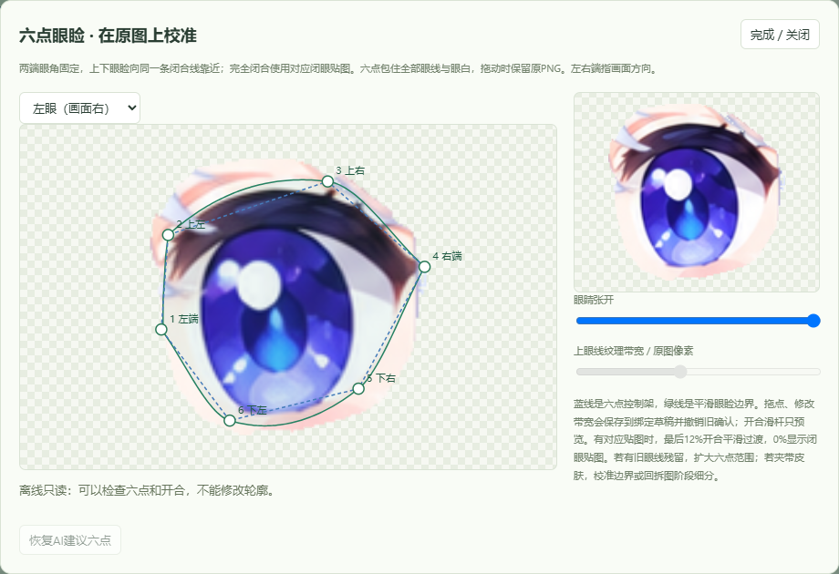

<details>
<summary>全身绑定截图</summary>

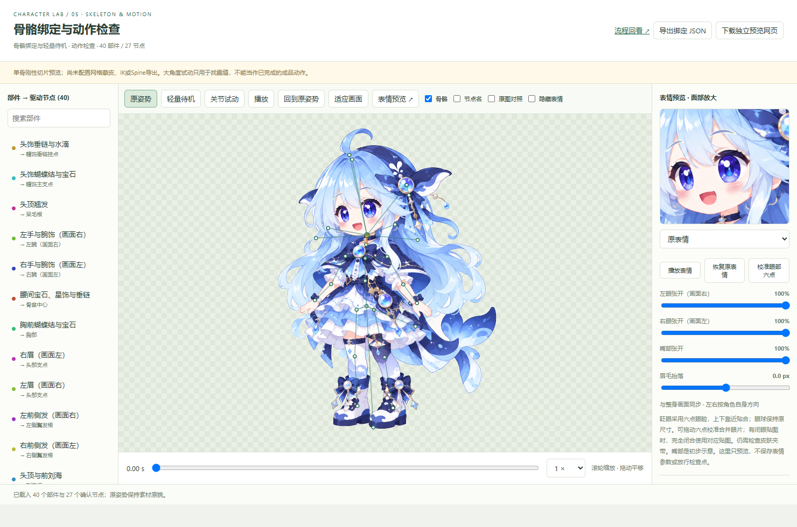

</details>

### 06 动画与调整

生成待机、起跑、跑步和收步动画，在同一个页面里检查循环和过渡。支持暂停、慢放和拖动时间轴，也能直接点选动画里的部件，调整层序、编辑像素，或选两层进入双色边界编辑。发现袖口露缝时，可以停在那一帧直接修。

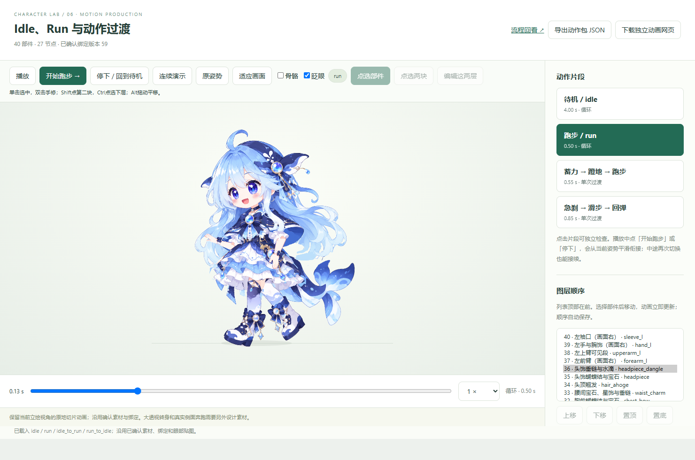

**离线示例：** 下载仓库后，用浏览器打开 [大肥鱼交互示例](character-rig-design/assets/examples/dafeiyu/index.html)。素材和脚本都在 HTML 里，可以断网播放、查看骨架、切换四段动作，也可以测试实时起停。GitHub 文件页显示的是源码，需要下载到本地打开。

## 快速开始

需要一个能读取图片、操作本地文件并运行 Python 的 AI 工作环境。AI 按 Skill 准备角色数据、生成各阶段网页，你在网页里检查和修改。

```bash
git clone https://github.com/aplainjane/picture2animation.git
cd picture2animation
python -m pip install -r requirements.txt
```

然后把角色图交给 AI，告诉它：

```text
使用这个仓库的 character-rig-design/SKILL.md。
从这张角色图开始，先执行阶段01，生成可调整骨骼节点的网页。
沿用仓库里的网页模板，在网页中等我确认，再进入下一阶段。
```

已有进度也可以接着来：

```text
恢复这个角色项目，先检查已有 workflow 和最新草稿。
保留我改过的素材、层序和绑定，这次只调整收步动作。
```

也可以把 `character-rig-design/` 放进 AI 工具的 Skill 目录，之后直接调用。主 Skill 会按阶段读取对应文档。

**运行环境：** Python 3，Pillow、NumPy、SciPy，现代浏览器。需要把 SVG 栅格化为 PNG 时，辅助脚本另外使用 Node.js、Playwright 和 Chromium；具体入口见[阶段04说明](character-rig-design/stages/04-material-result.md)。

## 阶段与产物

| 阶段 | 你检查什么 | 确认后交给下一步 |
| --- | --- | --- |
| 01 结构 | 节点位置、左右语义、父子关系 | 结构与骨骼坐标 |
| 02 拆图 | 轮廓、层序、空面部与独立表情 | 最新切片和裁切坐标 |
| 03 计划 | 补全、局部SVG、清理的勾选范围 | 实际处理计划与备注 |
| 04 素材 | 修复前后、颜色和接缝 | 最终素材 |
| 05 绑定 | 驱动节点、关节试动、眼部六点 | 绑定及表情资产 |
| 06 动作 | 循环、过渡、最终素材和层序 | 动画HTML、完整JSON、版本记录 |

各阶段文档开头的**网页使用与交接卡**列出了输入文件、网页操作、保存与确认方式，以及产物位置。

- **保存草稿**：记录当前修改，方便继续做。
- **整阶段确认**：由你在网页点击，服务写出 `confirmed.json`；AI 检查有效后才进入依赖它的下一步。
- **导出／下载**：生成当前成果的副本。离线交付可随时导出，并记录真实确认状态。

下载文件或勾选单项“已检查”不代表整阶段确认。你改过的素材、眼部控制点、层序和绑定会继续用于后续阶段。

## 目录结构

```text
picture2animation/
├── README.md                    中文首页
├── README.en.md                 English
├── docs/media/                  实际流程截图、GIF和项目图标
└── character-rig-design/
    ├── SKILL.md                 AI从这里进入
    ├── stages/                  六阶段说明与网页交接卡
    ├── references/              格式、复用约定和大肥鱼动作说明
    ├── scripts/                 生成、审阅、检查点和导出工具
    └── assets/                  六个网页模板及运行脚本
        └── examples/dafeiyu/    内嵌素材的完整离线示例
```

每个新角色单独建项目目录，保存自己的原图、配置和成果：

```text
你的角色项目/
├── input/                       原图与生成输入
├── stage01-review.html          各阶段网页，依次到stage06
├── stage01-review.workflow/     每阶段各有一个workflow目录
│   ├── draft.json              最新已保存草稿
│   ├── confirmed.json          人工确认快照
│   └── workflow.json           阶段、修订和依赖
├── history/                     各阶段只读回看
├── review-history.html          回看入口
└── delivery/                    可播放HTML、完整JSON、release.json
```

完整的调用命令和文件去向见[项目产物与交接约定](character-rig-design/references/project-artifacts.md)。继续编辑时从最新草稿恢复；进入下游时读有效确认快照，避免把你手修的结果换回初始版本。

## 能力与限制

目前适合制作 2D 切片角色的待机、眨眼、原地跑步和动作过渡。大肥鱼是仓库里完整跑通的示例，新角色还需要逐步检查拆图、绑定和动作。

目前使用单骨刚性切片和局部条带变形。复杂转身、透视变化、隐藏区域的大幅展开仍需要额外素材或设计；当前没有网格蒙皮、IK求解或Spine工程导出。新图的拆分和补全也需要结合原画判断。已有动作预设可作起点，再按角色体型、原始肢段方向和用户要求适配。

## 文档与反馈

- [主 Skill](character-rig-design/SKILL.md)：阶段路由与共同约定。
- [网页模板复用](character-rig-design/references/template-reuse.md)：后续AI如何直接调用已有工具。
- [大肥鱼动作示例](character-rig-design/references/dafeiyu-motion-example.md)：四段动作、实时衔接与小幅收步。
- [动作JSON](character-rig-design/assets/examples/dafeiyu/motion.json)：不含图片，方便按节点研究关键帧。

遇到问题可以提 [Issue](https://github.com/aplainjane/picture2animation/issues)，附上截图、部件名称和出问题的动作时刻。比如“run 的 0.2 秒，左肘露了一条缝”，比一句“跑得有点怪”好找得多。拆图或绑定有更顺手的做法，也欢迎交流。

<sub>流程截图与动画来自仓库中的大肥鱼案例；项目图标由项目作者提供。示例图像的使用不代表获得相关角色或美术素材的再授权。</sub>
